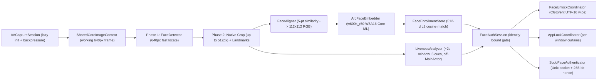

<h1 align="center">
  <br>
  <a href="https://github.com/pearleseed/glance"></a>
  <br>
  Glance
  <br>
</h1>

<h3 align="center">Face unlock, App Lock, and Face-for-sudo for your Mac</h3>

<p align="center">
  <a href="LICENSE"></a>
  
  
</p>

Glance brings the Face ID-like experience of your iPhone to your Mac — unlock your Mac with a glance, lock individual apps behind face verification, and optionally authenticate `sudo` in Terminal with 1-click setup. Everything runs 100% on-device using Apple's Vision and Core ML frameworks (powered by an upgraded **ArcFace `w600k_r50` W8A16** ResNet50 model), so your face data and Mac password never leave your machine. The UI lives seamlessly in your MacBook's notch (or a floating Dynamic Island pill on notchless Macs and external monitors).

https://github.com/user-attachments/assets/77438826-80a9-4ab2-9fc3-42407a2d0adb

---

> [!WARNING]
> ## Read before using
> ## Glance is not as secure as Apple's Face ID or Touch ID
>
> MacBooks don't come equipped with the hardware depth/infrared sensors that make iPhone Face ID trustworthy and secure. An iPhone builds a 3D map of your face; a Mac webcam sees a flat 2D image. That means:
>
> - Glance defeats, with reasonable confidence, a printed photo and a photo on a phone screen (Heavy liveness detection must be turned on)
> - Glance does not reliably defeat a high-resolution video replay of you
> - macOS has no public API that lets a third-party app authorize a lock-screen login, so lock-screen Face Unlock works by typing your encrypted password into the lock screen
> - App Lock is a **privacy convenience** that holds while Glance is running, not an OS-enforced security boundary
>
> Glance is a convenience feature, not a security upgrade. Only use it — and especially opt-in features like **Unlock session at login** or **Face-for-sudo** — if you accept this tradeoff.

---

## Installation

**Requirements:**
- macOS 14 Sonoma or later
- Apple Silicon (`arm64`) or Intel (`x86_64`) Mac

<a href="https://github.com/pearleseed/glance/releases/latest" target="_self"></a>

1. Download the `.dmg` matching your Mac (`arm64` for Apple Silicon, `x86_64` for Intel) from [GitHub Releases](https://github.com/pearleseed/glance/releases/latest) (or [build from source](#building-from-source)).
2. Open the `.dmg` and drag **Glance.app** to `/Applications`.
3. Community release builds are **ad-hoc signed** (not notarized with a paid Apple Developer ID), so clear macOS Gatekeeper quarantine once before first launch:
   ```bash
   xattr -cr /Applications/Glance.app
   ```
4. Launch **Glance** and complete the guided onboarding.

> [!NOTE]
> **Upgrading from v2.0.0:** Glance v2.1.0 upgrades its recognition model from MobileFaceNet (`w600k_mbf`) to ResNet50 (`w600k_r50`, W8A16). Previously enrolled faces are automatically marked stale and require a quick one-time re-enrollment for the improved accuracy.

---

## Permissions

| Permission | Why |
|---|---|
| **Camera** | To recognize your face on-device. Frames are processed in memory and never written to disk. |
| **Accessibility** | To type your password into the lock screen and listen for the optional **On space** trigger. (Not required for App Lock or `sudo`.) |
| **Touch ID / Device Password** | Protects the 256-bit Keychain key that encrypts your face data and password, guards App Lock settings changes, and serves as fallback authentication. |
| **Automation (Apple Events) *(optional)*** | Requested only when using 1-click **Set Up / Repair / Update / Uninstall** in **Settings → Sudo** to prompt for macOS administrator credentials. |
| **App Management *(optional)*** | macOS may request this once if 1-click Sudo setup replaces an existing `/Applications/Glance.app`. Glance links directly to **System Settings → Privacy & Security → App Management** if needed. |

---

## How It Works

1. **Continuous circular enrollment:** Launch Glance and follow the guided onboarding in the notch. Glance calibrates your camera's neutral angle on a straight-on look, then lets you smoothly rotate your head in any direction to capture nine poses with zero-blur live ring feedback and trackpad haptics. Each pose becomes a 512-dimensional **ArcFace `w600k_r50`** *embedding*, and the image is discarded immediately.
2. **Encrypted credentials:** Enter your Mac password once. It is encrypted with AES-GCM under a Keychain-protected 256-bit session key gated by Touch ID or your Mac password.
3. **Event-driven fast wake & unlock:** When your Mac locks, wakes from sleep, returns from a screensaver, or receives a Space press at the lock screen, Glance pre-warms the camera lazily and expands the notch/pill animation without background polling loops.
4. **Verified unlock:** Once an enabled identity matches at native resolution **and** identity-bound liveness confirms a real person, Glance safely clears stray text and injects your password.

---

## Features

### Lock Screen Face Unlock, Recognition & Performance

| Feature | Description |
|---|---|
| **Upgraded ArcFace `w600k_r50` (W8A16) engine** | Uses InsightFace's ResNet50 backbone quantized to W8A16 (~42 MB vs. 83 MB FP16) with architecture-aware Core ML compute units (`.cpuAndNeuralEngine` on Apple Silicon — ~2.1 ms median inference on M3 ANE; `.cpuOnly` BNNS on Intel without GPU shader warmup), zero-copy Float16/Float32 output extraction, and calibrated confidence presets (`0.55` / `0.62` / `0.68`). |
| **Event-driven low-latency & battery-friendly pipeline** | Loads ArcFace asynchronously off the main thread into a **single shared `FaceRecognitionPipeline`** app-wide. Unifies Core Image work into `SharedCoreImageContext`, lazily initializes `AVCaptureSession` with frame backpressure, replaces 200 Hz scan polling and 60 Hz lock-screen timers with event-driven delivery, eliminates duplicate Vision landmark/crop passes, skips liveness work when disabled, and offloads zero-allocation geometry math off `@MainActor`. |
| **Lower idle RAM & deadline-driven timers** | Releases hidden Night Boost panels when inactive, unmounts closed Settings view hierarchies, avoids locked-state Keychain IPC, switches App Lock reconciliation to deadline-driven timers, and enables timer coalescing across background tasks. |
| **Flexible unlock triggers** | Trigger on **wake**, on **lock**, on pressing **Space** at the lock screen, or automatically when returning to a **screensaver-locked** screen (even under Secure Event Input). Hover the notch to retry, or enable one automatic retry on failure. |
| **Adaptive seated & full-res recognition** | Automatically recognizes naturally seated users and wide-angle webcams (e.g., Studio Display, iMac, Logitech BRIO) by locating the face quickly and matching from a native-resolution crop (up to 512 px). Enable **Strict close range** in Recognition settings to ignore distant faces in busy spaces. |
| **Night Boost *(opt-in)*** | Designed for dark rooms: softly illuminates the top 38% of your display (keeping the password field unobstructed, restoring original brightness immediately when done or on quit, and releasing the panel when hidden) and boosts low-light frames for recognition without contaminating glare detection. |
| **Global toggle shortcut** | Enable or disable Face Unlock from anywhere with a customizable hotkey (default `⌃⌥⌘F`, no extra permissions needed) with subtle audio confirmation (*Tink* on, *Pop* off) and conflict warnings. |

### Display, Camera & Session Controls

| Feature | Description |
|---|---|
| **Display-context gating (*Active when*)** | Independently toggle Face Unlock for **Built-in only**, **Built-in + external**, and **External only** (clamshell) setups across all triggers. |
| **Clamshell & hot-plug camera support** | Filters out suspended built-in cameras when your MacBook lid is closed, automatically switches to usable external/Continuity cameras, and reacts to camera plug/unplug events without restarting Glance. Configure separate camera overrides for built-in vs. external displays. |
| **Multiple identities & pose-aware quality** | Enroll several people or multiple appearances (glasses, beard, different lighting), toggle any identity on/off without deleting, and see fair pose-aware capture quality grades. |
| **Session & Keychain management** | Configurable **Auto lock session** idle timeout (defaults to 30 days, or *Never*), locked-state **Reset stored data** recovery, no double password prompts on non-Touch ID Macs, an optional **Unlock session at login** toggle *(off by default)* for Touch ID-free Macs, and seamless `LAContext` + Login Keychain fallback on ad-hoc builds. |
| **Menu bar & keyboard ergonomics** | Hide or show the menu bar icon (relaunch from Spotlight/Finder to bring Settings back) and open Settings anytime via the app menu (`⌘,`). |

### Notch & Dynamic Island UI

| Feature | Description |
|---|---|
| **Notch & pill styles** | Choose **Original** (full expansion), **Minimal** (compact flank view with dedicated 120 px Lanczos-downscaled assets for crisp Retina rendering), or turn animations off completely (**Headless** mode). Automatically adapts to a floating pill on notchless Macs and external displays. |
| **Dynamic animation colors** | Recolor animations at runtime in linear light with asynchronously built video compositions (zero extra video bloat): **Blue** (classic), **Green** (`#34C759`), or **Blue → Green** (blue while scanning, green on unlock confirmation). |
| **Smooth GPU-light rendering** | Cached continuous-corner Bézier geometry in `NotchShape`, zero-blur `Canvas` circular enrollment ring & sweep animations, reused camera preview shape layers, native macOS scroll edge blur in Settings, and subtle trackpad haptics. |
| **Physical notch size tuning** | Fine-tune notch **Width** and **Height** (`-20 pt` to `+20 pt`) to align pixel-perfectly with your Mac's camera housing. |

### App Lock *(Opt-in)*

Guard individual macOS applications behind face recognition (found in **Settings → Apps**, off by default):

- **Per-window privacy curtains:** Covers only the locked app's windows at their exact z-order with optimized blur and tracking — no Screen Recording permission needed, and other apps in front remain unobstructed. Automatically hides challenged apps if Mission Control opens.
- **Zero extra model RAM:** Shares Glance's single app-wide ArcFace + liveness pipeline and provides **Touch ID / Mac password fallback** directly from the curtain.
- **Flexible monotonic relock policies:** Set a default policy and per-app overrides — **Every time**, **After 1 / 5 / 15 / 60 minutes**, or **1 / 5 / 15 minutes after leaving** — driven by deadline timers and monotonic system uptime so clock changes cannot bypass locks. Every unlocked app session revokes immediately on screen lock, sleep, or screensaver.
- **Fast app picker & built-in safeguards:** Modifying App Lock settings or the app list requires Touch ID / Mac password. Critical system & recovery apps (Glance, Finder, System Settings, Terminal, Activity Monitor) are protected from locking, while third-party terminals and IDEs display a caution notice. Discovers installed apps quickly by parsing `Info.plist` directly with async icon caching (`AppIconCache`), plus a custom `.app` chooser.

### Face Authentication for `sudo` *(Opt-in)*

Authenticate local `sudo` commands in Terminal with your face — cascading seamlessly **Face (Heavy Liveness) → Touch ID → Mac password** (found in **Settings → Sudo**, off by default):

- **1-click in-app Setup, Repair, Update & Uninstall (zero source code or Xcode CLT needed):** `Glance.app` bundles a pre-compiled universal (`arm64` + `x86_64`) `pam_glance.so` (`Contents/Helpers/pam_glance.so`) and self-contained setup helper (`Contents/Resources/glance-sudo-setup.sh`) that relies only on standard macOS system tools:
  - Open **Glance → Settings → Sudo** and click **Set Up** (or **Repair** / **Update** when SHA-256 detects an outdated `/usr/local/lib/pam/pam_glance.so`).
  - Stages the bundle into a user-owned temp directory first (avoiding TCC `Operation not permitted` when launched from `Downloads`, `Desktop`, or a `.dmg`), prompts once for macOS administrator credentials, atomically installs or fixes `/Applications/Glance.app` with rollback (including lowercase `glance.app` casing), installs `/usr/local/lib/pam/pam_glance.so`, inserts `pam_glance.so` before `pam_tid.so` in `/etc/pam.d/sudo_local`, sets `root:wheel` ownership, and relaunches directly back to **Settings → Sudo** (`--open-settings-tab sudo`).
  - Click **Uninstall** anytime to remove `/usr/local/lib/pam/pam_glance.so`, clean `/etc/pam.d/sudo_local` (preserving `pam_tid.so`), turn off the toggle, and restore normal user ownership on `/Applications/Glance.app` so you can move it to Trash cleanly.
  - Includes direct **Open App Management Settings** guidance if macOS blocks replacing an existing app bundle, plus collapsible **Manual Terminal commands** pointing straight to the bundled script.
- **Zero password injection:** Uses a native universal (`arm64` + `x86_64`) OpenPAM module installed strictly in `/etc/pam.d/sudo_local` (survives macOS updates; `/etc/pam.d/sudo` is never touched).
- **Hardened local-only verification:** Refuses remote/SSH/headless sessions (`PAM_RHOST` and macOS audit session flags via `getaudit_addr`) and `root` invocations; verifies peer UID (`getpeereid`), executable path (`LOCAL_PEERPID` + `proc_pidpath` == `/Applications/Glance.app/Contents/MacOS/glance`), root-owned non-writable binary (`lstat`), root-only socket clients (`uid == 0`), a `0700` socket directory, and a fresh **256-bit random nonce** (`arc4random_buf`) on every request.
- **Heavy Liveness enforced:** Always runs Heavy liveness regardless of your lock-screen liveness setting. If Glance is closed, locked, disabled, or fails to match, `sudo` immediately falls through to Touch ID and password.

If you prefer compiling and installing manually from a source checkout (requires Xcode Command Line Tools `clang`), see [sudo-support/README.md](sudo-support/README.md):

```bash
sudo chown -R root:wheel /Applications/Glance.app
sudo bash sudo-support/install.sh
```

---

## Privacy and Security

Glance is designed to keep biometric data and credentials strictly on-device.

### Face data
Glance never stores camera images. During enrollment, each captured face is converted into a **512-dimensional ArcFace (`w600k_r50`) embedding** using Core ML and the frame is discarded. Embeddings are stored locally and encrypted with **AES-GCM**. Glance explicitly refuses to authorize unlocks if the ArcFace model fails to load (weak Vision feature-print fallback is never accepted for unlock).

### Credentials & Keychain
Your Mac password is never written to disk in plaintext. It is encrypted with AES-GCM under a **256-bit AES session key** stored in Keychain:

- **Apple-signed builds (preferred):** Stores the session key in the **macOS Data Protection Keychain** protected by `.userPresence` (Touch ID or device password), and stores the encrypted password blob with `AfterFirstUnlockThisDeviceOnly` so lock-screen Face Unlock remains reliable even on Macs that lock their data protection keybag on screen lock.
- **Ad-hoc signed community builds:** When Data Protection Keychain entitlements (`errSecMissingEntitlement`, `-34018`) are unavailable, Glance falls back transparently to authenticating via **`LAContext.evaluatePolicy(.deviceOwnerAuthentication)`** (Touch ID, Apple Watch, or Mac login password) before creating or reading the session key from the macOS **Login Keychain**.
- The unwrapped session key lives only in memory while a session is active. *(If you explicitly opt in to **Unlock session at login**, an ungated device-only copy of the session key is stored in Keychain so macOS login becomes the single authentication gate.)*

### Hardened unlock pipeline
Glance unlocks only when **all** of the following hold simultaneously:

1. Onboarding and the security notice have been completed, and no enrollment flow is active.
2. A valid Glance session is unlocked, Face Unlock is enabled globally, and the current display context is enabled.
3. The Mac is authoritatively confirmed to be at the lock screen (`CGSessionCopyCurrentDictionary`).
4. ArcFace (`w600k_r50`, never a weak fallback) matches an enabled, non-stale identity above the configured threshold.
5. **Identity-bound liveness** accepts that same matched identity (confirmations reset on face loss or identity swap, while spoof deny cues stay latched across the scan).
6. Accessibility permission is granted.

During injection, Glance decodes UTF-8 password bytes directly into a mutable `[UInt16]` buffer wiped with `memset_s` (avoiding immutable heap `String` copies), posts batched grapheme-safe Unicode events through an isolated `.privateState` `CGEventSource` with cleared modifier flags (immune to Caps Lock or held wake keys), and re-verifies the lock screen before every step.

### How it tells a face from a photo
Five independent cues over a rolling ~2 s window, in two roles:

- **Deny cues** detect spoofs and override everything — **face-contour-masked screen glare** (ignoring background lights/windows beside the jaw and temples) and **multi-candidate device bezel detection** (checking all detected rectangles so background monitors cannot mask a phone held over the face).
- **Confirm cues** confirm a real 3D face — flat-vs-3D landmark geometry, **2D roll-invariant** eye-aspect-ratio blink dynamics, and **eye-aligned** nose parallax across head turns. Any single confirm cue is enough, and their absence alone never denies a live person sitting still.

**Light** mode runs deny cues only; **Heavy** mode requires both deny and confirm cues (and is always enforced for `sudo`).

### Face Lab
Face Lab is a hidden debug console for testing recognition scores and live liveness cues (lazily loaded so it uses zero extra RAM when closed).

**To open it:** **Settings → About**, then click the app icon 5 times. A **Face Lab** tab appears in the tab bar for the current launch.

---

## For Developers

### Tech Stack & Dependencies

| Layer | Implementation |
|---|---|
| **Language & UI** | Swift 5 (`SWIFT_DEFAULT_ACTOR_ISOLATION = MainActor`, strict concurrency), SwiftUI + AppKit (`NSPanel`, `NSWindow`, `AVPlayerLayer`, `Canvas`) |
| **Target Platforms** | macOS 14.0+ Sonoma, Universal (`arm64` Apple Silicon & `x86_64` Intel) |
| **Vision & ML** | Apple Vision (2-phase face detection, landmarks, rectangles), Core ML (`MLProgram`), Core Image (`SharedCoreImageContext`), Accelerate (`vImage`) |
| **Recognition Model** | InsightFace **ArcFace `w600k_r50`** (ResNet50 backbone, **W8A16** per-channel symmetric int8 weight quantization, 512-d embedding) |
| **Security & OS APIs** | CryptoKit (AES-GCM), Security (Data Protection Keychain + Login Keychain fallback), LocalAuthentication (`LAContext`), CoreGraphics (`CGSession`, `CGEvent`), IOKit HID, Carbon (`RegisterEventHotKey`), SkyLight (lock-screen overlay space) |
| **`sudo` PAM Module** | Native C (`sudo-support/pam_glance.c`), compiled to universal `arm64` + `x86_64` OpenPAM bundle (`Contents/Helpers/pam_glance.so`) |
| **Third-Party Packages** | **1 SwiftPM dependency:** [Sparkle](https://github.com/sparkle-project/Sparkle) `2.10.1` (auto-updates) |
| **Code Quality** | `swift-format` ([`.swift-format`](.swift-format)) + `SwiftLint` ([`.swiftlint.yml`](.swiftlint.yml), 0 strict violations across 121 Swift files) |

### System Architecture & Recognition Pipeline

All authentication flows (Lock Screen Unlock, App Lock, Face-for-`sudo`, Onboarding, and Face Lab) share a **single asynchronously loaded `FaceRecognitionPipeline`** and a unified `SharedCoreImageContext` so model weights and GPU contexts are never duplicated in memory.



### Project Structure

```text
glance/
├── App/            # App entry point (macOS 14/15 scenes), AppEnvironment DI root, POCController
├── AppLock/        # Pure AppLockEngine state machine, monotonic RelockPolicy, per-window curtains, AppIconCache
├── Camera/         # Lazy AVCaptureSession, frame backpressure, hot-plug/clamshell catalog, SharedCoreImageContext
├── Core/           # GlobalHotKey (Carbon), LaunchAtLogin, NotificationObserverBox
├── FaceLab/        # Hidden debug console (lazy-loaded recognition + live liveness diagnostics)
├── Liveness/       # 5-cue anti-spoofing: face-masked glare, multi-candidate bezel, roll-invariant blink, parallax, 3D geometry
├── Models/         # Bundled Core ML ArcFace.mlpackage (w600k_r50 W8A16, ~42 MB)
├── NightBoost/     # Top-38% low-light screen illuminator, display brightness control, bounded frame gain
├── NotchOverlay/   # Notch/pill geometry (cached Bézier), SkyLight lock-screen window, linear-light AnimationTint
├── Onboarding/     # Neutral-pitch calibration, omnidirectional 9-pose circular enrollment, zero-blur Canvas ring/sweep
├── Recognition/    # FaceDetector, FaceAligner, ArcFaceEmbedder, FaceRecognitionPipeline, FaceAuthSession, FaceEnrollmentStore
├── Security/       # KeychainManager (Data Protection + LAContext/Login fallback), SecureCredentialManager, SecureFaceStore, SessionAutoLocker
├── Settings/       # Settings window, tab bar, reusable components, and per-feature pages (incl. Sudo 1-click UI)
├── SudoAuth/       # SudoAuthServer (Unix socket), SudoAuthProtocol (256-bit nonce), SudoPAMStatus (SHA-256), SudoPAMInstaller
├── Unlock/         # LockMonitor (authoritative CGSession), SpaceKeyMonitor (IOKit HID), KeystrokeInjector, FaceUnlockCoordinator
└── Updater/        # Sparkle SPUStandardUpdaterController wrapper
sudo-support/       # pam_glance.c (OpenPAM C module), glance-sudo-setup.sh (bundled 1-click helper), manual CLI scripts
tools/              # convert_arcface.py (ONNX -> Core ML W8A16/FP16 + parity check), 10 offline Swift self-test suites
```

### Core ML Model & Benchmarks

Glance bundles InsightFace's **`w600k_r50`** ResNet50 backbone converted to a Core ML `MLProgram` with **W8A16** (per-channel symmetric `int8` weights, `float16` activations) quantization and RGB `(px - 127.5) / 127.5` normalization baked directly into the model graph.

| Property | Value |
|---|---|
| **Model Identifier** | `arcface-w600k_r50-v1` (replaces v2.0 `w600k_mbf` MobileFaceNet) |
| **Input / Output** | `input_image`: `112×112` aligned RGB (`CVPixelBufferPool`) → `embedding`: `512` floats (L2-normalized in Swift) |
| **Compute Units** | Apple Silicon (`arm64`): `.cpuAndNeuralEngine` · Intel (`x86_64`): `.cpuOnly` (BNNS directly, no GPU shader warmup) |
| **Output Fast-Path** | Contiguous `MLMultiArray.withUnsafeBytes` + `loadUnaligned` (`arm64` native `Float16`; `x86_64` `vImageConvert_Planar16FtoPlanarF`) |
| **Match Presets** | Less strict: `0.55` · Standard: `0.62` · More strict: `0.68` |

#### Measured Model Benchmarks (Apple M3, 30 runs)

| Variant | Size on Disk | ONNX ↔ Core ML Parity (`CPU_AND_NE`) | `.cpuAndNeuralEngine` Median (min / p95) | `.cpuOnly` BNNS Median (min / p95) | Model Load (`ANE` / `CPU`) |
|---|---:|---:|---:|---:|---:|
| **`w600k_r50` W8A16 (shipped)** | **42 MB** (`42,804 KiB`) | **0.999129** *(min 0.998774 across 4 seeds)* | **2.07 ms** *(1.68 / 2.64 ms)* | **9.40 ms** *(9.10 / 9.83 ms)* | `948.6 ms` / `111.9 ms` |
| `w600k_r50` FP16 (reference) | 83 MB (`85,292 KiB`) | 0.997707 | 2.51 ms | 8.73 ms | `975.8 ms` / `85.8 ms` |

> W8A16 cuts the bundled model footprint in half (~42 MB vs. 83 MB) while running ~18% faster on the Apple Silicon Neural Engine with higher ONNX numerical parity. See [tools/README.md](tools/README.md) to regenerate or swap variants via `tools/convert_arcface.py`.

#### Key v2.1 Performance & Efficiency Architecture
- **Startup & Memory:** ArcFace loads asynchronously off `@MainActor` into one shared pipeline; closed Settings SwiftUI views unmount cleanly; hidden Night Boost panels are released; locked-state Keychain IPC is avoided.
- **Zero-Polling Scan & Idle Energy:** Event-driven frame delivery and lock-state waiting replace 200 Hz `Task.sleep` loops and 60 Hz lock-screen timers; App Lock uses deadline-driven timers; background timers enable coalescing.
- **Vision & GPU Hot Paths:** Single-pass Vision landmarks & native crop (skipping liveness extraction completely when disabled), off-`@MainActor` zero-allocation `GeometryLiveness`, zero-blur `Canvas` enrollment animations, cached `NotchShape` Bézier coefficients, async tinted `AVVideoComposition`, direct `Info.plist` app scanning, and async `AppIconCache`.

### Building from Source

#### Prerequisites
- macOS 14 Sonoma or later (runtime)
- Xcode 16+ / 26+ (`xcrun clang` is invoked automatically by the **Bundle Sudo PAM Support** Xcode Run Script phase to compile universal `pam_glance.so` and copy `glance-sudo-setup.sh` into `Glance.app`)

#### Build & Run
1. Clone the repository:
   ```bash
   git clone https://github.com/pearleseed/glance.git
   cd glance
   ```
2. Open in Xcode:
   ```bash
   open glance.xcodeproj
   ```
3. Select your Development Team under **Signing & Capabilities** (required for Data Protection Keychain entitlements; ad-hoc / unsigned local builds fall back seamlessly to `LAContext` + Login Keychain) and press `Cmd + R`.

Or build from the command line:
```bash
# Debug build (unsigned/local)
xcodebuild -project glance.xcodeproj -scheme glance -configuration Debug CODE_SIGNING_ALLOWED=NO build

# Release builds by architecture (arm64 or x86_64)
xcodebuild -project glance.xcodeproj -scheme glance -configuration Release \
  -destination 'generic/platform=macOS' ARCHS=arm64 ONLY_ACTIVE_ARCH=NO \
  CODE_SIGNING_ALLOWED=NO CODE_SIGNING_REQUIRED=NO build

# Full signed dual-architecture release + Sparkle appcast.xml (arm64 + x86_64 DMGs, SHA256SUMS.txt, appcast.xml)
./tools/build_release.sh
```

> [!NOTE]
> Keep `sudo-support/` in the source tree — Xcode's **Bundle Sudo PAM Support** build phase compiles `sudo-support/pam_glance.c` into `Contents/Helpers/pam_glance.so` (`arm64` + `x86_64`) and embeds `sudo-support/glance-sudo-setup.sh` into `Contents/Resources/` so distributed `.dmg` builds are completely self-contained.
>
> **Publishing a GitHub Release with Sparkle auto-updates:**
> 1. Bump `MARKETING_VERSION` and `CURRENT_PROJECT_VERSION` in `glance.xcodeproj/project.pbxproj` (and fallback strings in `AboutSettingsPage.swift`).
> 2. Run `./tools/build_release.sh` — it builds and signs both `arm64` and `x86_64` `.dmg` files, cross-checks your Keychain EdDSA key (`--account com.pearleseed.glance`) against `SUPublicEDKey` in `glance/Info.plist`, and generates a verified `build/release/appcast.xml`.
> 3. Upload **all 4 files** (`Glance-<ver>-arm64.dmg`, `Glance-<ver>-x86_64.dmg`, `SHA256SUMS.txt`, and **`appcast.xml`**) to the GitHub Release so `SUFeedURL` (`https://github.com/pearleseed/glance/releases/latest/download/appcast.xml`) resolves cleanly.

### Code Style, Linting & Offline Self-Tests

Format and lint before opening a PR:
```bash
xcrun swift-format format -i --recursive glance tools
swiftlint lint --strict
```

Glance includes **10 standalone, camera-free Swift self-test suites** under `tools/` (each file documents its exact `swiftc` compile-and-run command in its header comment):

| Test Suite | Coverage |
|---|---|
| `tools/liveness_selftest.swift` | 5-cue liveness scoring, 2D roll invariance, flat-vs-3D geometry, identity-bound resets |
| `tools/security_selftest.swift` | ArcFace fallback refusal, multi-identity matching, UTF-16 `memset_s` keystroke hygiene, multi-candidate bezels |
| `tools/performance_selftest.swift` | `ArcFaceEmbedder` compute units & Float16 fast-path, shared pipeline/context, frame backpressure, `InstalledApps`, `NotchShape`, `AnimationTint` |
| `tools/glare_mask_selftest.swift` | Face-contour polygon masking excluding background glare while preserving forehead speculars |
| `tools/notch_ui_selftest.swift` | Linear-light `UnlockAnimationColor` tinting and physical notch size bounds |
| `tools/enrollment_pose_selftest.swift` | Neutral-pitch camera calibration and omnidirectional 9-pose circular matching |
| `tools/night_boost_selftest.swift` | Rec. 709 luminance thresholds, bounded low-light gain, brightness restore & termination cleanup |
| `tools/applock_selftest.swift` | `AppLockEngine` v2 state machine, monotonic `RelockPolicy`, deadline timers, system blacklist & Touch ID fallback |
| `tools/sudo_installer_selftest.swift` | `glance-sudo-setup.sh` atomic install/rollback/uninstall, `SudoPAMCommandBuilder`, error classification, SHA-256 outdated probe |
| `tools/sudo_protocol_selftest.swift` | Strict 256-bit nonce validation, `0700` socket permissions, root peer UID checks, and server lifecycle cleanup |
| `tools/settings_window_selftest.swift` | Settings window close/reopen/minimize lifecycle, stable `WindowConfiguringView` identity, and one-shot chrome configuration |
| `tools/test_generate_appcast.py` | Sparkle `appcast.xml` ordering (`arm64` before `x86_64`), `SUPublicEDKey` migration check, EdDSA signing & tamper detection |

---

## Acknowledgements

- **[The Boring Notch](https://github.com/TheBoredTeam/boring.notch)** — for the notch window physics.
- **[InsightFace](https://github.com/deepinsight/insightface)** — the ArcFace (`w600k_r50`) model powering on-device recognition.
- **[Alcove](https://tryalcove.com)** — big design inspiration.

## License

[MIT](LICENSE) © 2026 [pearleseed](https://github.com/pearleseed) (originally created by Jonathan Zhou)
